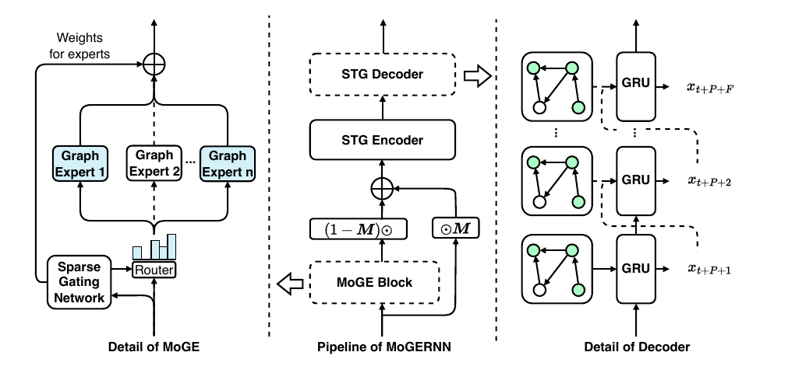
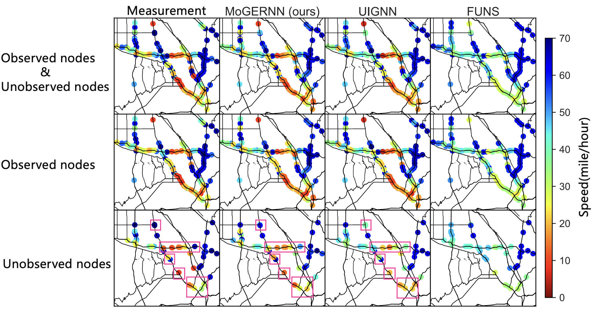
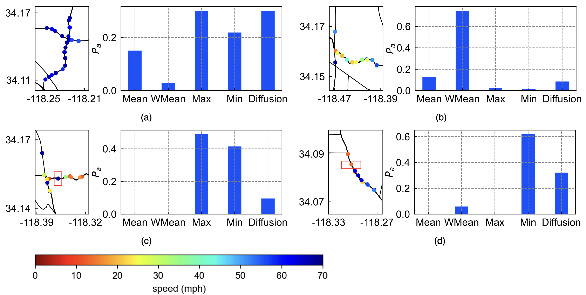

# MoGERNN
The repo is the official implementation for the paper published in Transportation Research Part C: [MoGERNN: An Inductive Traffic Predictor for Unobserved Locations](https://www.sciencedirect.com/science/article/pii/S0968090X25000841).

## Introduction

Given a partially observed road network, how can we predict the traffic state of interested unobserved locations? 

Traffic prediction is crucial for advanced traffic management systems, with deep learning approaches showing exceptional performance. However, most existing approaches assume sensors are deployed at all locations of interest, which is impractical due to financial constraints. Furthermore, these methods typically require costly retraining when sensor configurations change. 

To address these challenges, we introduce MoGERNN, a novel inductive spatio-temporal graph representation model that enables accurate prediction for unobserved locations while maintaining adaptability to structural changes in the sensor network. 

## Overall Architecture
MoGERNN is composed by two key modules: 1. Mixture of Graph Experts (MoGE), which is aiming for unobserved node embedding 2. Spatio-temporal Graph Encoder-Decoder (STGED), which aims for future state prediction for both observed nodes and unobserveds.


## Usage
1. Install the environment
```sh
conda env create --file environment.yml
```
2. Download the dataset from [Google Cloud](https://drive.google.com/file/d/1VCPGVljJzdBTfhardAiOZNimxGDXiOiw/view?usp=sharing) and put them into ./data/
3. Train the model
```sh
bash scripts/MoGERNN-train.sh
python utils/report_results.py
```
4. Test model performance in the changed sensor network.
```sh
bash scripts/MoGERNN-test_for_new_env.sh
```
5. Reproduce based on a pre-trained model or checkpoints.
```sh 
bash scripts/MoGERNN-inference.sh
```
## Main Results

Map presentation of prediction results

Visualization of graph expert contributions across multiple scenarios

## Additional Experimental Details

1. The retrained counterpart

For the retrained counterpart, we adopted a simplified offline setting in which historical observations from the original training period were assumed to be available for the sensors treated as newly added in the experiment. We included these observations in retraining, alongside those from the existing sensors, and evaluated the model on the original test period. This provided an offline retraining reference for the expanded sensor set while retaining the original temporal training–test split. The assumed availability of historical observations should be distinguished from a deployment in which measurements only become available after a sensor is physically installed.

2. The inference-time experiment

The inference-time experiment was intended to assess the computational benefit of executing only the experts selected by sparse gating. For this experiment, we modified the execution procedure to first compute the gating weights and then skip the computation of experts assigned zero weight. The public release retains the original implementation used for the main predictive-performance experiments, which computes all expert outputs before weighted aggregation, including those assigned zero weight. The timing-specific execution procedure was not included in that release; consequently, the released code alone does not reproduce the timing results.

## Citation
If you find this repo helpful, please cite our paper.

```
@article{MoGERNN,
  title = {{{MoGERNN}}: {{An}} Inductive Traffic Predictor for Unobserved Locations},
  author = {Zhou, Qishen and Zhang, Yifan and Makridis, Michail A. and Kouvelas, Anastasios and Wang, Yibing and Hu, Simon},
  year = {2025},
  month = may,
  journal = {Transportation Research Part C: Emerging Technologies},
  volume = {174},
  pages = {105080},
  issn = {0968090X},
  doi = {10.1016/j.trc.2025.105080}
}
```


## Acknowledgement
We appreciate the following GitHub repo for their valuable code and efforts.
- [IGNNK](https://github.com/Kaimaoge/IGNNK)

## Contact
If you have any questions, feel free to contact:
- Qishen Zhou (qishenzhou@intl.zju.edu.cn)
